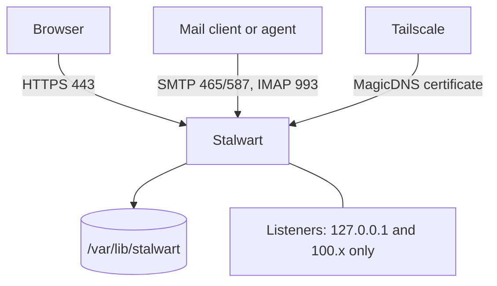

# Tailnet mail

A private mail server for a Tailscale tailnet, installed by one script. People
and agents get real SMTP/IMAP accounts, a browser client, and a trusted
certificate without exposing anything to the public internet.

## Table of Contents

- [About](#about)
- [Documentation](#documentation)
- [Features](#features)
- [Tech Stack](#tech-stack)
- [Architecture](#architecture)
- [Project Structure](#project-structure)
- [Getting Started](#getting-started)
- [Configuration](#configuration)
- [Security](#security)
- [How to Contribute](#how-to-contribute)
- [What's Next](#whats-next)
- [License](#license)
- [Acknowledgements](#acknowledgements)
- [Author](#author)

## About

Tailnet mail is a small, private mail system for one Tailscale tailnet. It
installs Stalwart for SMTP, IMAP4, JMAP, and HTTPS, serves Bulwark Lite at
`/webmail/`, and uses a Tailscale-issued certificate for the node's MagicDNS
name. Every listener binds to loopback and the `100.x` address; there is no MX
record, port forwarding, or internet mail.

The installer reads the node's MagicDNS name from `tailscale status` and its
IPv4 address from `tailscale ip -4`, asks for the mail domain and mailbox names,
prints the plan, then configures Stalwart through its Bootstrap API. `--check`
verifies an install, `--diagnose` writes a redacted support bundle, and
`--reconfigure` re-renders listeners after a tailnet IP change.

Read [00-overview](docs/00-overview.md) for the design and [the ADR
index](docs/adr/README.md) for why the boundaries sit where they do.

## Documentation

| Audience | Start here |
|---|---|
| New install | [Quick start](docs/02-quickstart.md) |
| Mailbox user | [User guide](docs/user-guide.md) |
| Server operator | [Administrator guide](docs/admin-guide.md) |
| Design and decisions | [Overview](docs/00-overview.md), [ADRs](docs/adr/README.md) |
| Operations | [Operations](docs/04-operations.md), [Troubleshooting](docs/05-troubleshooting.md), [Security](docs/06-security.md) |
| Accounts and agents | [Accounts and agents](docs/03-accounts-and-agents.md) |
| Migration | [Migrating from Dovecot](docs/07-migrating-from-dovecot.md) |
| Questions | [FAQ](docs/08-faq.md) |
| Changelog | [CHANGELOG.md](CHANGELOG.md) |
| Release notes | [Unreleased](docs/releases/unreleased.md) |
| License | [MIT](LICENSE) |
| Third-party notices | [THIRD-PARTY-NOTICES.md](THIRD-PARTY-NOTICES.md) |

## Features

| Feature | What it does |
|---|---|
| Mail server | Stalwart handles SMTP, IMAP4, JMAP, and HTTPS in one Rust binary. |
| Webmail | Bulwark Lite is served by Stalwart at `/webmail/`; there is no separate web server. |
| Admin and account UI | `/admin` for management, `/account` for self-service passwords and app passwords. |
| TLS | A Tailscale-issued certificate covers the node's MagicDNS name. |
| Accounts | Internal Stalwart accounts; the full email address is the username. |
| Agents | One account and one app password per agent. |
| No public exposure | Listeners bind to loopback and the `100.x` address only. |
| Verification | `--check` tests listeners, TLS, IMAP login, and the webmail, admin, and account pages. |

### Agent client

`scripts/tailmail.py` covers the common agent operations with the Python
standard library:

```bash
python3 scripts/tailmail.py send --to user@<host>.<tailnet>.ts.net \
    --subject "Build finished" --body "All tests passed."
python3 scripts/tailmail.py inbox --limit 10
python3 scripts/tailmail.py read 42
```

It reads `~/.config/tailmail/config`; the installer writes it for the account
that ran `setup-mail.sh`, pointed at the first agent account.

## Tech Stack

| Layer | Choice |
|---|---|
| Installer | Bash, run as root on Debian or Ubuntu |
| Mail and web | Stalwart (Rust). The installer uses the official `get.stalw.art` installer and does not pin a Stalwart version. |
| Admin CLI | `stalwart-cli` 1.0.14, pinned in `setup-mail.sh` |
| Webmail | Bulwark Lite from the latest GitHub release (`BULWARK_URL` in `setup-mail.sh`) |
| Identity and TLS | Tailscale MagicDNS and HTTPS certificates |
| Service management | systemd, including `mail-cert-renew.timer` |
| Firewall | Optional ufw rules on `tailscale0` |
| Agent client | Python 3 standard library only (`scripts/tailmail.py`) |
| Hosts | Debian 12/13 or Ubuntu 24.04/26.04, x86_64 or aarch64 |

## Architecture



Stalwart owns the mail ports, the data store, and the certificate object.
Bulwark Lite is an `Application` object served from the same origin as JMAP, so
there is no Node process, nginx, or CORS configuration. The renewal timer
updates the `Certificate` object over JMAP and restarts Stalwart only when the
certificate changes.

The decisions behind these boundaries are recorded in
[ADR-0001](docs/adr/0001-single-stalwart-process.md),
[ADR-0002](docs/adr/0002-tailnet-only-listeners.md), and
[ADR-0006](docs/adr/0006-bulwark-lite-as-application.md).

## Project Structure

```
setup-mail.sh              installer and phase runner
mail-setup.conf.example    unattended configuration sample
make-dist.sh               builds the hand-off tarball
scripts/tailmail.py        minimal SMTP/IMAP client for agents
docs/                      topic guides, user and admin guides, ADRs, release notes
docs/adr/                  architecture decision records
docs/releases/             release notes
LICENSE                    MIT license for the project's original code and docs
THIRD-PARTY-NOTICES.md     upstream licenses and the distribution boundary
```

## Getting Started

### Prerequisites

- Debian 12/13 or Ubuntu 24.04/26.04, x86_64 or aarch64
- Tailscale installed and logged in, with MagicDNS and HTTPS certificates enabled
- Ports 25, 465, 587, 993 and 443 free
- Root access
- 2 GB free on `/var`; the installer warns below this

### Install from a checkout

```bash
git clone https://github.com/Untethered-Explorers/stalwart-tailnet-mail.git
cd stalwart-tailnet-mail
./make-dist.sh
tar xzf dist/stalwart-tailnet-mail-*.tar.gz
cd stalwart-tailnet-mail-*
sudo ./setup-mail.sh
```

The installer asks for the hostname, mail domain, mailbox names, and whether to
install the webmail. It prints the plan for confirmation before changing
anything. Credentials go to `/root/mail-credentials.txt` (mode 0600); move them
to a password manager and delete the file.

### Verify

```bash
sudo ./setup-mail.sh --check
```

### Unattended install

```bash
cp mail-setup.conf.example mail-setup.conf
# edit mail-setup.conf
sudo ./setup-mail.sh --config mail-setup.conf --yes
```

See [02-quickstart](docs/02-quickstart.md) for the phase list and the web-wizard
fallback.

## Configuration

### Installer flags

| Flag | Effect |
|---|---|
| `--preflight` | Run the checks only; change nothing |
| `--check` | Verify an existing install |
| `--diagnose` | Write a redacted support bundle to `/root` |
| `--resume` | Continue from the last completed phase |
| `--reconfigure` | Re-render listeners after a tailnet IP change |
| `--no-webmail` | Skip Bulwark Lite |
| `--domain <name>` | Override the domain (certificate caveat) |
| `--config <file>` | Load values from a file |
| `--yes` | Do not prompt |

### Configuration file

`mail-setup.conf.example` documents the accepted variables:

| Variable | Default when blank |
|---|---|
| `MAIL_HOST` | This node's MagicDNS name from `tailscale status` |
| `MAIL_DOMAIN` | `MAIL_HOST` |
| `HUMAN_USER` | The user running `sudo` |
| `AGENT_USERS` | No agent accounts |
| `WEBMAIL` | `yes`; set `no` to skip Bulwark Lite |

`--domain` overrides `MAIL_DOMAIN`. `--no-webmail` overrides `WEBMAIL`. The
script does not prompt when `--config` is used with `--yes`.

A custom `--domain` needs its own certificate: the Tailscale certificate only
covers the MagicDNS name. The generated renewal script also targets
`MAIL_DOMAIN`, so replace it or disable `mail-cert-renew.timer` when you use a
custom domain. See [01-prerequisites](docs/01-prerequisites.md) and the
[Administrator guide](docs/admin-guide.md#configuration).

## Security

Accounts are internal to Stalwart. Passwords are hashed with Stalwart's default
scheme; app passwords are per-device secrets for agents and cron. The `admin@`
account is for management only. The tailnet is the security boundary: all
listeners bind to loopback and the `100.x` address, and there is no internet
mail, spam filtering, or DKIM for public receivers.

Secrets live in `/root/mail-credentials.txt`, `/root/stalwart-api-key`,
`/root/stalwart-recovery-password`, and `~/.config/tailmail/config`; each is
mode 0600. Backups of `/var/lib/stalwart` contain the mail and settings and must
be treated as sensitive.

Report vulnerabilities privately to the maintainer at
[@McFuzzySquirrel](https://github.com/McFuzzySquirrel), not in a public issue.
See [06-security](docs/06-security.md) and the [Administrator
guide](docs/admin-guide.md#security-and-privacy-checklist) for hardening.

## How to Contribute

There is no `CONTRIBUTING.md` and no CI workflow. The current workflow is:

1. Open an issue or pull request at
   [Untethered-Explorers/stalwart-tailnet-mail](https://github.com/Untethered-Explorers/stalwart-tailnet-mail).
2. Keep changes focused and update the docs that describe the behavior you
   changed.
3. Run the available checks before opening a pull request:

   ```bash
   bash -n setup-mail.sh
   python3 -m py_compile scripts/tailmail.py
   ./make-dist.sh
   git diff --check
   ```

4. Test installer changes on a disposable tailnet first. The `--preflight` mode
   checks the host without changing it.
5. Add an ADR under `docs/adr/` for a durable design decision, and a
   `CHANGELOG.md` entry for a notable change.

The maintainer reviews pull requests. There is no automated test suite, so
describe the manual checks you ran.

## What's Next

These are known gaps, not shipped behavior:

- No tagged release and no CI or automated test suite.
- Stalwart upgrades are manual; the installer does not pin a Stalwart version or
  keep a rollback binary.
- No metrics are wired up. Stalwart can expose Prometheus metrics and tracing.
- No internet mail, spam filtering, malware filtering, or DKIM for public
  receivers. This is a private tailnet system by design.
- The Dovecot migration path in
  [07-migrating-from-dovecot](docs/07-migrating-from-dovecot.md) depends on the
  external Vandelay tool and has not been validated in this repository.
- A custom `--domain` needs an externally supplied certificate; the Tailscale
  certificate only covers the MagicDNS name.

Possible next work, not planned or scheduled: a tagged release, a smoke-test
script for the installer, and a pinned Stalwart version with a documented
rollback. Open an issue if you want to work on one of these.

## License

The project's original source code and Markdown documentation are licensed under
the [MIT License](LICENSE). That covers `setup-mail.sh`, `make-dist.sh`,
`scripts/tailmail.py`, `mail-setup.conf.example`, and the Markdown docs.

Third-party software is not covered by that license. Stalwart and
`stalwart-cli` are AGPL-3.0-only OR SELv2; Bulwark Lite is AGPL-3.0-only with an
additional app-store permission; Tailscale is BSD-3-Clause. The installer
downloads or installs these at runtime, and none of their binaries are bundled
in this repository or the tarball. See
[THIRD-PARTY-NOTICES.md](THIRD-PARTY-NOTICES.md) for the full list and links.

## Acknowledgements

- [Stalwart](https://stalw.art/) for the mail server and `stalwart-cli`.
- [Bulwark](https://github.com/bulwarkmail/webmail) for Bulwark Lite.
- [Tailscale](https://tailscale.com/) for MagicDNS and HTTPS certificates.
- Debian and Ubuntu for the supported host distributions.
- Python's standard library, which is the only dependency of
  `scripts/tailmail.py`.

## Author

Maintainer: [McFuzzySquirrel](https://github.com/McFuzzySquirrel).

Open issues and pull requests at
[Untethered-Explorers/stalwart-tailnet-mail](https://github.com/Untethered-Explorers/stalwart-tailnet-mail).
For security reports, contact the maintainer privately instead of opening a
public issue.
